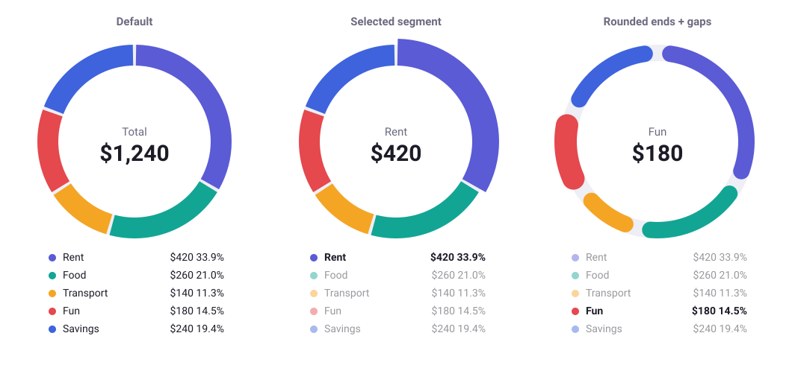

# interactive_donut

[](https://pub.dev/packages/interactive_donut)
[](https://github.com/senkop/interactive_donut/actions/workflows/ci.yml)
[](LICENSE)

An animated, interactive donut chart for Flutter. It has **no dependencies** and works on mobile, web and desktop.

- Animated reveal when the chart first appears and whenever the data changes
- Hover highlight on web and desktop, tap to select on every platform
- Any widget in the center, rebuilt for the hovered or selected segment
- Gaps between segments, rounded ends and a background track
- A matching `DonutLegend` that stays in sync with the chart
- Screen-reader label generated from your data
- Pure, tested geometry helpers if you want to build your own chart



## Install

```bash
flutter pub add interactive_donut
```

## Usage

```dart
import 'package:interactive_donut/interactive_donut.dart';

DonutChart(
  size: 240,
  segments: const [
    DonutSegment(value: 45, color: Colors.indigo, label: 'Rent'),
    DonutSegment(value: 30, color: Colors.teal, label: 'Food'),
    DonutSegment(value: 25, color: Colors.amber, label: 'Fun'),
  ],
  centerBuilder: (context, index) => Text(index == null ? 'Total' : 'Segment $index'),
  onSelectionChanged: (index) => debugPrint('selected: $index'),
)
```

### Keeping a legend in sync

```dart
int? selected;

Row(
  children: [
    DonutChart(
      size: 220,
      segments: segments,
      selectedIndex: selected,
      onSelectionChanged: (i) => setState(() => selected = i),
    ),
    DonutLegend(
      segments: segments,
      selectedIndex: selected,
      valueFormatter: (v) => '\$${v.toStringAsFixed(0)}',
      onTap: (i) => setState(() => selected = selected == i ? null : i),
    ),
  ],
)
```

## DonutChart options

| Parameter | Default | Description |
| --- | --- | --- |
| `segments` | required | The slices, drawn clockwise in order |
| `size` | `null` | Width and height. When `null`, the chart is a square sized by its parent |
| `thickness` | `24` | Ring thickness |
| `gapDegrees` | `2` | Space between segments, in degrees |
| `startAngleDegrees` | `-90` | Where the first segment starts (-90 = 12 o'clock) |
| `animationDuration` | `900ms` | Reveal animation length (`Duration.zero` disables it) |
| `curve` | `easeOutCubic` | Reveal animation curve |
| `highlightExpansion` | `6` | How far the hovered or selected segment grows |
| `trackColor` | `null` | Background ring color |
| `roundedEnds` | `false` | Rounded segment ends |
| `enableHover` | `true` | Highlight segments on mouse hover |
| `enableSelection` | `true` | Select segments on tap |
| `selectedIndex` | `null` | The selected segment. The chart follows it when it changes |
| `centerBuilder` | `null` | Builds the widget in the hole |
| `onSegmentTap` | `null` | Called with the tapped segment index |
| `onSelectionChanged` | `null` | Called with the new selection (`null` when cleared) |
| `onHoverChanged` | `null` | Called with the hovered segment (`null` when none) |
| `semanticsLabel` | auto | Accessibility label |

## Example

A full demo with shuffling data, a legend and live styling controls is in [`example/`](example/lib/main.dart):

```bash
cd example
flutter create .
flutter run -d chrome
```

## Contributing

Issues and pull requests are welcome. Please run `dart format .`, `flutter analyze` and `flutter test` before opening a PR.

## License

MIT
